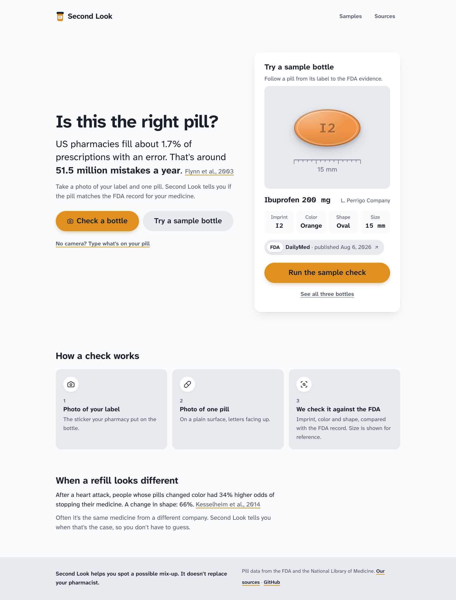
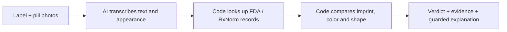

# Second Look

Photograph a pharmacy label, then pour your pills onto a towel and snap one photo. Second Look checks every pill against the FDA records for that medicine, shows the evidence, and gives you words to use when calling your pharmacist. If a pill's writing is face-down or it looks different from the rest, it circles just that pill: flip it where it is and snap again, and only the flipped pills are read again.

[Open the app](https://getsecondlook.vercel.app) · [Try a sample](https://getsecondlook.vercel.app/samples) · [Type a check](https://getsecondlook.vercel.app/type)

<!-- research-headline -->
On 150 fresh NIH photos (300 label–photo pairs), Second Look called 1 of 150 wrong pills fine. When it answered, it was right 83 of 88 times; it said “can't tell” 70.6% of the time. [All safety, coverage and development results](https://getsecondlook.vercel.app/research).
<!-- /research-headline -->

Phase 5's **coverage goal was not met**. Vedhanth accepted the honest result and authorized its production release on November 10. The frozen headline above stays unchanged. Phase 6 fixes a short-imprint safety bug and close-color two-view handling; its cached rescore is labelled **post-hoc, not a fresh test**. [Frozen report and post-hoc comparison](https://github.com/Vedu-2011/second-look/blob/main/research/REPORT.md) · [Interpretation](https://github.com/Vedu-2011/second-look/blob/main/research/INTERPRETATION.md) · [One-page PDF](https://getsecondlook.vercel.app/second-look-one-pager.pdf).



## Why this matters

A national observational study estimated about **51.5 million dispensing errors a year** in US community pharmacies, based on 1.7% of roughly 3 billion prescriptions ([Flynn et al., 2003](https://pubmed.ncbi.nlm.nih.gov/12688437/)). This is historical, addressable error burden, not a claim of errors prevented by this app.

Among patients taking heart medicines after a heart attack, a pill color change was associated with **34% higher odds of stopping medicine**; a shape change, **66%** ([Kesselheim et al., 2014](https://pubmed.ncbi.nlm.nih.gov/25023248/)). A different-looking refill can be the same drug from another maker. That is a separate result here.

## How it works

AI reads. Code decides.



The photo readers run in parallel. The pill reader may suggest a medicine as a lead, but the engine only names it after an exact imprint match in that drug's FDA records. An explanation is generated from the computed facts and checked for invented names, numbers, and advice; rejected or malformed output uses a template.

Results: Matches; Same medicine, different maker; Doesn't match; or We can't tell. Low confidence and missing evidence lead to abstention. Size is shown from the FDA record, never measured or used as a pass/fail from a photo.

## Real data

- [FDA DailyMed](https://dailymed.nlm.nih.gov/dailymed/): label evidence, publication dates, imprint, color, shape, size, maker.
- [NLM RxNorm / RxNav](https://lhncbc.nlm.nih.gov/RxNav/): product codes and every maker's version of a drug and strength. Duplicate packages are merged. Responses are cached for 24 hours in Redis.
- [NIH/NLM pill image dataset](https://data.lhncbc.nlm.nih.gov/public/Pills/index.html): real reference and consumer photos for testing. It does not decide a user's verdict. Dataset details: [Yaniv et al.](https://pubmed.ncbi.nlm.nih.gov/29854569/).

Every result links to its records. `/sources` loads current product counts. Saved examples say whether they use recorded FDA fields or real demo photos; fictional labels use Alex Rivera at Maple Street Pharmacy. No exact demo-pill phone photos are bundled yet.

## Run locally

Use Node.js 22.9+ and npm. Install dependencies with `npm install`. Copy `.env.example` to `.env.local`, then set `ANTHROPIC_API_KEY` and the Upstash `KV_REST_API_URL` / `KV_REST_API_TOKEN`. Model overrides are `VISION_MODEL` and `TEXT_MODEL`; `DAILY_CHECK_CAP` defaults to 500. Environment values stay on the server.

```sh
npm run dev
npm test
npm run lint
npm run build
npm run smoke:fda
npm run smoke:ai
```

The AI smoke script requires a production build and a live API key. It starts a local production server, runs the real readers, and calls `/api/check`. It reports readings, verdict, timing, estimated reader cost, and the saved result page status.

## Demo photos and labels

Open `/labels` to print three 3.5 × 2 inch labels on US Letter paper at 100% scale, browser headers/footers off. Query parameters edit all fields: `?ndc=70010-065&mfr=Granules`; prefix a field with `match.`, `different-maker.`, or `mismatch.` to edit one label.

Put `label.jpg` and `pill.jpg` in each applicable `test-images/real/{match,different-maker,mismatch}/` folder. Read its README for the intended medicine. Use only fictional patient details: these demo images become public.

```sh
npm run samples:build
```

The builder applies orientation, resizes to 1600px, strips EXIF, runs the same live pipeline as `/api/check`, and saves public photos plus dated JSON results. Empty folders keep the saved FDA example. Failed reads keep the previous result. Commit generated files to publish. The sample's live button reruns the stored photos through the rate-limited API and falls back to the saved check if unavailable.

## Pour and snap (whole-bottle check)

`/check` opens on **Check my pills**. Photograph the label, then pour the pills onto something dark, like a towel or plate, and spread them out. Code finds and numbers every pill (no AI), the Sonnet reader transcribes each crop, and the deterministic FDA engine checks each one.

- **Red** if any pill doesn't match, read from either side ("93" alone or "2263" alone is enough). Naming what the wrong pill is needs both sides.
- **Looks different**: code compares each pill's size, shape and color with the other pills in the same photo. An odd one out is never green and is the first pill we ask about.
- **Writing face-down**: a pill that looks like the confirmed ones but shows no writing isn't confirmed. We ask you to flip just that pill, at most 3 at a time.
- **Touching or cut-off pills** are circled and never counted as checked.
- **Green** only when every pill we found is confirmed by its imprint. We only check the pills we can see.

**Flip and snap again** matches the second photo to the first by pill positions, reads only the flipped (or newly separated) pills, and keeps the other readings. If the pills moved too much to match, it checks every pill again and says so. One check covers up to 5 re-read pills.

Shared bottle results contain readings, FDA evidence and numbered boxes on a neutral surface, **no uploaded photograph or crop**. These bottle rules are separate from the frozen single-pill benchmark.

`npm run bottle:composites` prepares three functional composites made from real NIH **development-cohort** consumer photographs on plain backgrounds, without AI calls. The first `npm run smoke:bottle -- --live` reads them with the production Sonnet reader under a durable $1 total cap; later `npm run smoke:bottle` replays cached readings without spending again. The smoke uses declared FDA labels, not AI label-photo readings. These examples are not part of the frozen benchmark and are not evidence of whole-bottle accuracy. Original benchmark results remain unchanged. Exact inputs, observed outcomes, spend and limitations are recorded in `HANDOFF.md`.

## Tests and limits

The network-free tests cover NDC formats, FDA parsing/cache/retries, imprint confusables, color/shape comparisons, deterministic verdicts, explanation checks, streamed steps, quotas, result expiry, editable labels, typed input, the sample builder, benchmark sampling/metrics/results validation, two-view conflicts, bounded transcription cleanup, continuation input/expiry and budget bounds. Live smoke checks are separate from unit tests.

## Another side, without rereading the first

When imprint text is absent, uncertain or incomplete, `/check` offers “Flip the pill over and take one more photo,” with a one-tap skip. The first reading stays in a short-lived server continuation (10 minutes); only the new photo is read. Both photos appear on your result locally, but neither is stored with a share link. Conflicting appearance remains uncertain. A two-view check is not proof that two photos show the same physical pill.

Phase 4 is now development data. Phase 5 freezes the code before a product-disjoint NIH holdout. `npm run research` only regenerates complete cached results; a new paid run requires an explicit `--run`, a matching frozen implementation and the separate $5 spending guard. The report, freeze hash, individual outcomes, raw readings and cost ledger are public under `research/`. Never tune on the holdout and then call it fresh evidence.

This is a pharmacy double-check, not a diagnosis or a replacement for a pharmacist. It supports tablets/capsules with FDA records; unreadable or unlisted pills may remain unknown. A single photo cannot establish authenticity or measure size. Do not take a mismatched or uncertain pill until your pharmacist confirms it. User uploads are not saved as photos; result JSON expires after seven days. Demo photos are deliberately published. Checks are limited to 30/hour per IP and a configurable daily cap.
